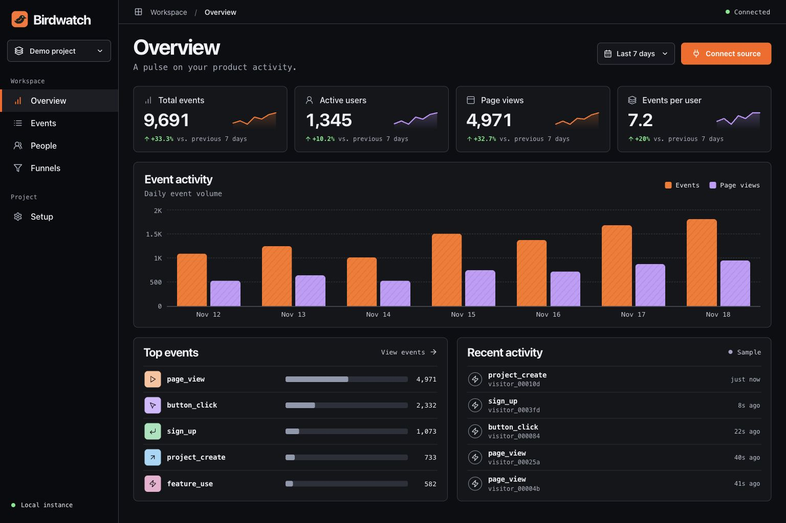

# Birdwatch

Birdwatch is an MIT-licensed, self-hosted product analytics app. Capture events from a website or a backend, inspect individual visitor histories, and measure conversion between two actions. A single Python process serves the dashboard, the browser client, and the HTTP API. SQLite stores the data locally.



## Run locally

With Python 3.9+ and SQLite 3.25+, start Birdwatch from a clone or an unpacked source distribution.

```sh
python3 server.py
```

Open [the local dashboard](http://127.0.0.1:8123). The distribution includes the compiled React dashboard, so Python is the only runtime dependency. No cloud account, external font, CDN, or telemetry service is involved.

On first launch the **Demo project** contains a frozen, read-only sample. Choose **Connect source → Create project** to collect your own events. The **Setup** page generates integration snippets with your project's write key. Use **Send test event** to write one event, then **View events** to inspect it.

For a fresh database that starts with one empty project, run `python3 server.py --no-demo`. Existing databases keep their projects across restarts. The default database is `data/birdwatch.sqlite3`, relative to `server.py`. Stop with Ctrl-C and use the same command to restart.

## Capture events

The [Birdwatch JavaScript and TypeScript SDK](sdk/README.md) supports browsers and Node.js 20+, with typed event catalogs, bounded batching, idempotent retries, and safe shutdown. Open **Setup → Browser SDK** or **Node.js** in your project to download the installable package and copy a configured example.

For React Native, Expo Exact, Swift, or Android, choose the matching tab in **Setup**. Offline events can be committed on-device with `enqueue` and replayed after a restart. Each tab includes a local package download and a project-specific example. See the [mobile and Exact SDK guide](sdks/README.md).


Paste the script from **Setup → Script tag** into the page you want to measure. It uses local storage for a per-project anonymous identity. The optional `data-pageview="true"` attribute sends one `page_view` per full page load, with only the URL path. In a single-page app, capture additional page views when your router changes pages.

```html
<script src="http://127.0.0.1:8123/birdwatch.js"
        data-key="YOUR_PROJECT_WRITE_KEY" data-pageview="true"></script>
```

After the script loads, identify a signed-in user and send an event. Identification applies to future events. Call `birdwatch.reset()` at logout to start a new anonymous identity.

```js
birdwatch.identify("user_42");
await birdwatch.capture("sign_up", { plan: "free" });
```

Server applications can use the HTTP API directly.

```sh
curl http://127.0.0.1:8123/api/capture \
  -H 'Content-Type: application/json' \
  -d '{"api_key":"YOUR_PROJECT_WRITE_KEY","event":"sign_up","distinct_id":"user_42","properties":{"plan":"free"},"uuid":"signup-user42-1"}'
```

A successful response returns `{"accepted":1,"duplicates":0}`. An optional `uuid` makes retries idempotent within a project. An optional `timestamp` must be ISO 8601 with a time zone. It defaults to server receipt time. The browser client returns a promise for the server response. It does not queue events offline.

For up to 100 events in one transaction, send `{"api_key":"YOUR_PROJECT_WRITE_KEY","batch":[...]}` with the event objects in the array. Invalid items reject the entire batch. Each request is limited to 1 MiB and each event's JSON-encoded properties to 32 KiB.

## Read the reports

- **Overview** shows event counts, distinct active IDs, page views, and events per active ID. Both `page_view` and `$pageview` count as page views. Hover or keyboard-focus a bar group to inspect a day. Select a top event to open its filtered stream.
- **Events** lets you search event names or people, inspect timestamps and JSON properties, and filter by a specific event or person.
- **People** lists distinct IDs, event counts, and first and last activity within the selected period. Select a person to see their event history.
- **Funnels** counts distinct people who completed event B after event A in the selected time range. The same event can be both steps if it occurs twice. Ties use insertion order. Each person counts once per step.

Reports use UTC calendar days and include today through the current moment. Overview compares the selected period with the same elapsed span starting one period earlier. A dash means the previous value was zero. Active projects refresh live views every five seconds. Historical event pages stay still while you inspect them. The sample project uses its frozen clock.

## Docker Compose

With Docker and its Compose plugin installed, set a password and start the service from the project directory.

```sh
export BIRDWATCH_PASSWORD="$(openssl rand -hex 24)"
docker compose up --build -d
```

Open [the local dashboard](http://127.0.0.1:8123) and sign in as `admin` with the value of `BIRDWATCH_PASSWORD`. Retrieve it in the same shell with `printenv BIRDWATCH_PASSWORD`. Save it for subsequent Compose commands, or supply it through a local `.env` file. Compose binds the published port to loopback and persists SQLite in the named `events` volume. Run `docker compose down` to stop it while keeping its data. The native server and Compose use separate databases and need different ports to run simultaneously.

## Hosting and storage

| Setting | Default | Purpose |
| --- | --- | --- |
| `BIRDWATCH_HOST` or `--host` | `127.0.0.1` | HTTP bind address (IPv4) |
| `BIRDWATCH_PORT` or `--port` | `8123` | HTTP port |
| `BIRDWATCH_DB` or `--db` | `data/birdwatch.sqlite3` | Database path |
| `BIRDWATCH_PASSWORD` | unset | HTTP Basic password for the dashboard user `admin` |

The loopback default allows local access without a password. Set a dashboard password before binding to a network interface or forwarding the service. For remote clients, terminate HTTPS at your reverse proxy, preserve the original Host header, and use the externally reachable HTTPS origin for the browser script. A localhost URL always refers to the visitor's own computer. If your site uses a Content Security Policy, allow the analytics origin in its script-src and connect-src directives.

The project write key is intentionally public and grants ingestion only. A dashboard administrator can read every project. For a public collector, apply request and traffic limits at the reverse proxy. This release targets a trusted single-operator workspace on a single host. It covers product analytics, with session replay, feature flags, and team roles outside its scope.

To back up an active database, use SQLite's online backup command. For Compose, run the equivalent Python backup from inside the container or stop the service before taking a volume snapshot.

```sh
sqlite3 data/birdwatch.sqlite3 ".backup 'birdwatch-backup.sqlite3'"
```

## Develop

The Python service uses only standard-library modules. The frontend sources are in `ui/src`, the tracker source and its build instructions are in `sdk/`, and deployable assets are in `static`. Rebuild the bundle after editing frontend files.

```sh
cd ui
npm ci
npm run build
cd ..
python3 -m unittest discover -s tests -v
python3 server.py
```

The integration suite uses temporary databases and ephemeral loopback ports. It exercises event capture, batch rollback, retry deduplication, UTC boundaries, ordered funnels, project isolation, access control, and reporting after reopening the database.

Birdwatch is released under the [MIT license](LICENSE). Third-party licenses for bundled dashboard code are included in [THIRD_PARTY_NOTICES.txt](THIRD_PARTY_NOTICES.txt).
